# NewsAPI ETL

This project fetches US science and business news using NewsAPI, transforms the response into pandas DataFrames, and loads the data into BigQuery. The Airflow DAG runs the ETL in a Kubernetes pod, checks the BigQuery tables, and copies them into the versioned `news_v2` dataset.

## Project files

- `app/main.py` — NewsAPI ETL application.
- `app/requirements.txt` — Python dependencies for the ETL image.
- `Dockerfile` — Builds the ETL container.
- `dags/newsapi_etl.py` — Airflow DAG.
- `docker-compose.yaml` — Optional local run of the ETL container; it does not start Airflow.

## Prerequisites

- Python and the dependencies in `app/requirements.txt`.
- Docker Desktop and Minikube for local container/Kubernetes execution.
- A local Airflow installation with the Kubernetes and Google providers installed. The DAG uses `KubernetesPodOperator`, `BigQueryCheckOperator`, and `BigQueryInsertJobOperator`.
- A NewsAPI key.
- A Google Cloud service-account JSON key with permission to create BigQuery jobs, datasets, and tables.
- An Airflow Google Cloud connection named `google_cloud_default`, configured with credentials that can check and copy the BigQuery tables.

For running the ETL directly from Python, install its dependencies in a virtual environment:

```bash
python3 -m venv .venv
source .venv/bin/activate
python -m pip install -r app/requirements.txt
```

Airflow and its providers are separate from `app/requirements.txt`. Install Airflow using the official constraints for your Python version, then install the Kubernetes and Google providers into the Airflow environment.

Keep API keys and credentials private. Do not commit `.env`, `newsapi-secret.env`, or `credentials.json`. The repository's ignore files exclude them from Git and Docker build contexts.

## Configure local credentials

Create a root-level `.env` file:

```dotenv
NEWS_API_KEY=replace_with_your_newsapi_key
GOOGLE_CONSOLE_PROJECT_ID=replace_with_your_gcp_project_id
```

For running the ETL directly with Docker Compose, place the service-account key at `credentials.json` in the project root. Compose mounts it read-only into the container.

For Kubernetes, create a file named `newsapi-secret.env` containing only:

```dotenv
NEWS_API_KEY=replace_with_your_newsapi_key
```

The DAG expects two Kubernetes Secrets in the `default` namespace:

- `newsapi-secrets`, with a `NEWS_API_KEY` key.
- `gcp-credentials`, with a `credentials.json` key containing the service-account JSON file.

## Run locally with Docker Compose

Build and run the ETL directly:

```bash
docker compose build
docker compose run --rm news-etl
```

This executes `app/main.py` directly. It does not run the Airflow DAG or launch Kubernetes pods.

## Run the Airflow DAG locally with Minikube

### 1. Start Minikube and select its context

```bash
minikube start
kubectl config use-context minikube
kubectl config current-context
kubectl get nodes
```

Confirm the current context is `minikube` and the node is `Ready`. Airflow runs outside the cluster in this setup, so the DAG uses the local kubeconfig (`in_cluster=False`).

### 2. Build the image into Minikube

From the project root:

```bash
minikube image build -t pythontask2-news-etl:latest .
minikube image ls | grep pythontask2-news-etl
```

If you build with Docker Desktop instead, load the image into Minikube:

```bash
docker build -t pythontask2-news-etl:latest .
minikube image load pythontask2-news-etl:latest
```

The DAG uses `image_pull_policy="IfNotPresent"` so Kubernetes can use the image stored in Minikube instead of trying to pull it from Docker Hub. Rebuild and reload the image after changing `app/main.py`.

### 3. Create the Kubernetes Secrets

Run these commands from the project root. They create or update the Secrets without printing their contents:

```bash
chmod 600 newsapi-secret.env credentials.json

kubectl create secret generic newsapi-secrets \
  --from-env-file=./newsapi-secret.env \
  --namespace default \
  --dry-run=client -o yaml | kubectl apply -f -

kubectl create secret generic gcp-credentials \
  --from-file=credentials.json=./credentials.json \
  --namespace default \
  --dry-run=client -o yaml | kubectl apply -f -
```

The DAG injects the NewsAPI key as `NEWS_API_KEY` and mounts the Google credentials file at `/var/secrets/google/credentials.json`. The ETL uses the project ID loaded by the DAG from `.env`.

Verify that the Secrets exist without displaying their values:

```bash
kubectl describe secret newsapi-secrets -n default
kubectl describe secret gcp-credentials -n default
```

The Google service account needs appropriate BigQuery permissions for both the ETL loads and the DAG's checks/copies. For a deployed environment, prefer workload identity or a managed secret store over a long-lived service-account key.

### 4. Configure and start Airflow

Use an Airflow environment with the Kubernetes and Google providers available. The DAG uses the Airflow connection ID `google_cloud_default` for BigQuery tasks; configure that connection in Airflow with valid Google Cloud credentials.

If needed, point local Airflow at this project's DAG directory before starting it:

```bash
export AIRFLOW__CORE__DAGS_FOLDER="$PWD/dags"
export GOOGLE_CONSOLE_PROJECT_ID="your-gcp-project-id"
airflow standalone
```

Open the Airflow UI, enable `newsapi_etl`, and trigger it manually. Alternatively, from a second terminal using the same Airflow environment:

```bash
airflow dags trigger newsapi_etl
```

The task flow is:

```text
run_etl_in_k8s
  -> check_articles_data and check_sources_data
  -> copy_sources_to_v2
  -> copy_articles_to_v2
```

## BigQuery outputs

The ETL creates the `news` and `news_v2` datasets in the `US` location and loads:

- `PROJECT_ID.news.sources`
- `PROJECT_ID.news.articles`

The DAG checks that article rows were published in the last three calendar dates and that the sources table contains rows. It then replaces the corresponding tables in `news_v2` with copies of the latest `news` tables.

Both ETL loads use `WRITE_TRUNCATE`, so each run replaces the contents of the base `news` tables before the DAG copies them to `news_v2`.

## Images
### Successful DAG run:
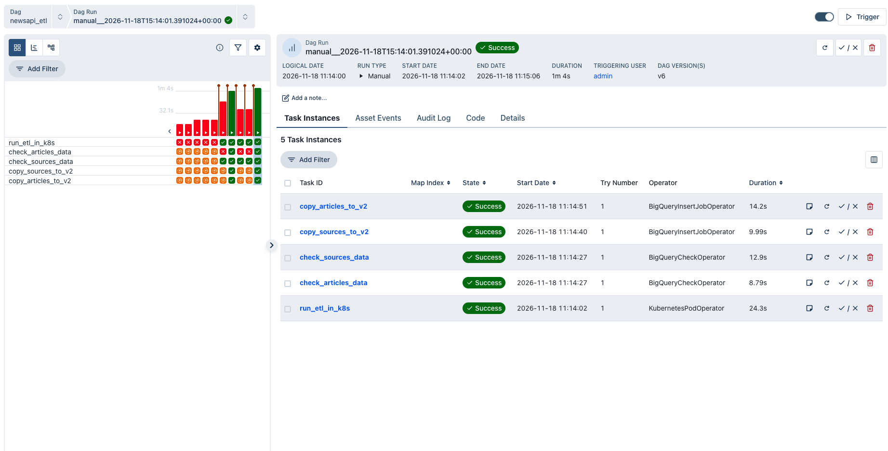

### BigQuery Results:
news and news_v2 datasets are created
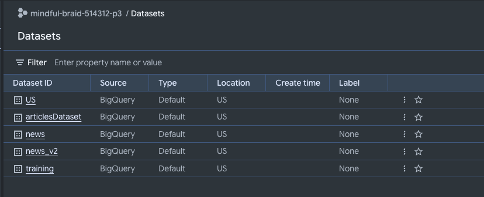

articles and sources tables (on both datasets)
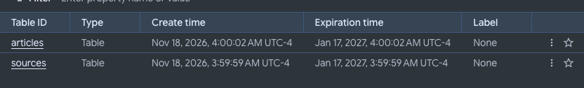

articles schema and data
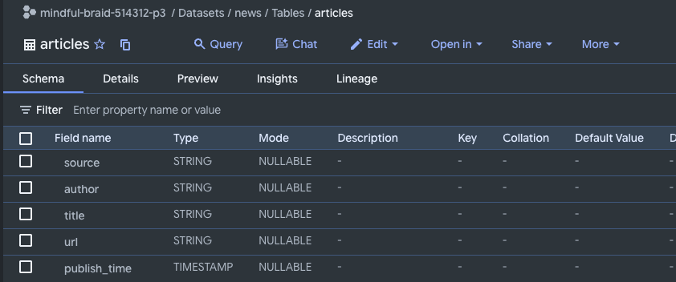

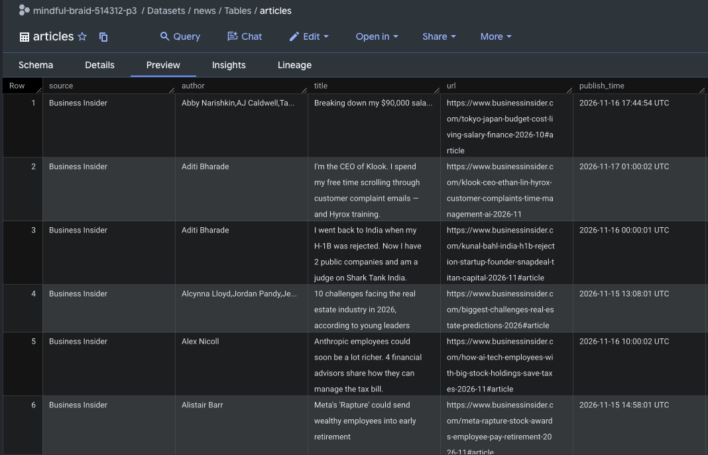

sources schema and data
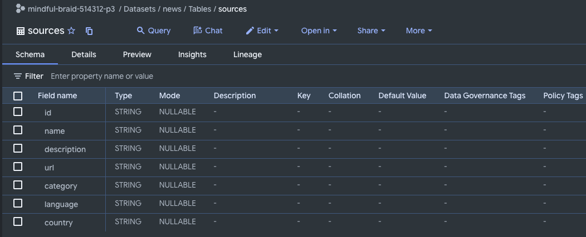

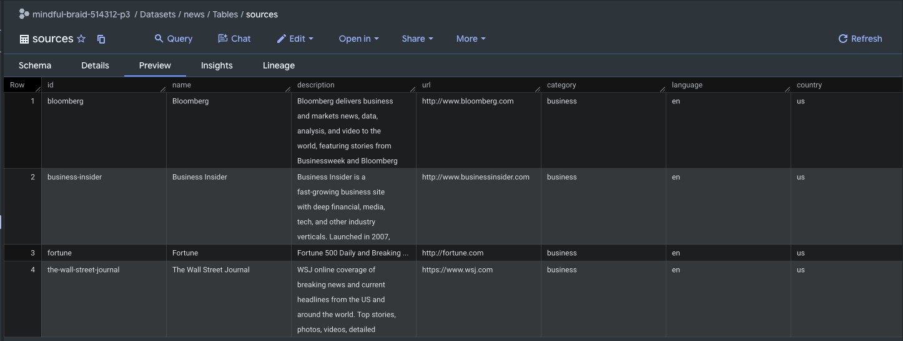

### News v2 results:
Tables
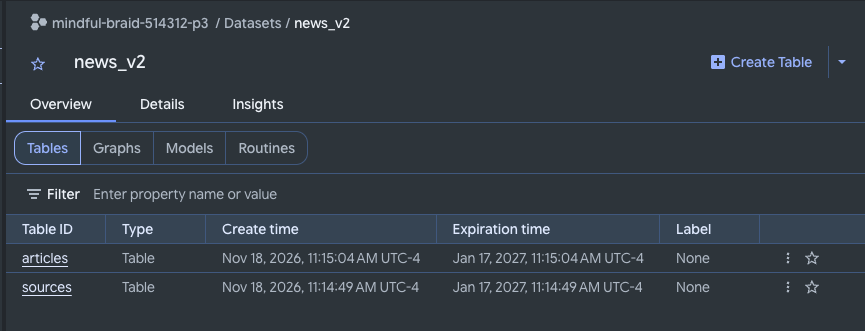

Articles
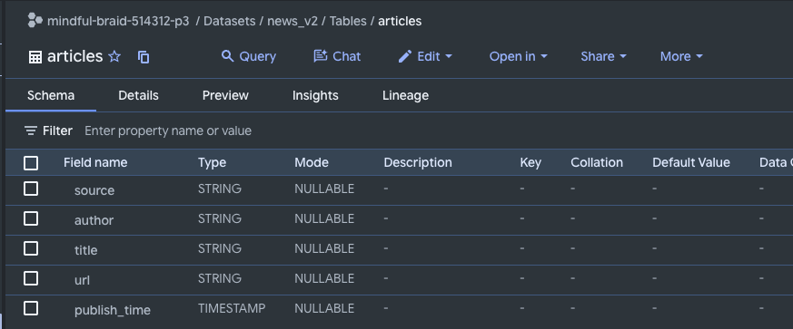

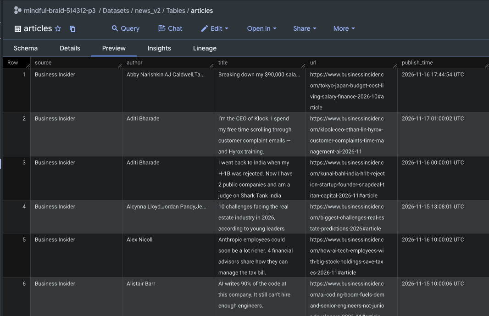

Sources
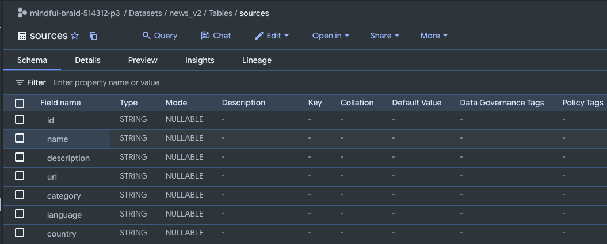

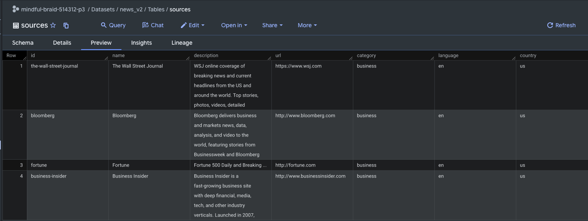